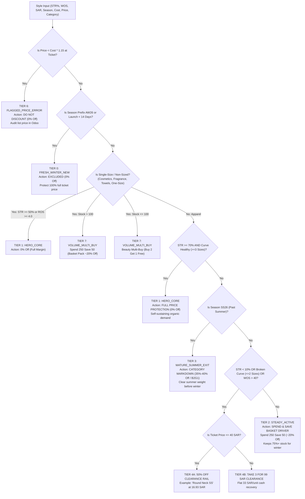

# CARINA Discount Planner AI: Coding & Logic SSOT (Algorithms, Math & Implementations)

> [!IMPORTANT]
> **DEVELOPER & AGENT IMPLEMENTATION ANCHOR:**  
> This document is the **Single Source of Truth for all algorithms, TypeScript implementations, mathematical formulas, and business logic** in the project. Whenever implementing, modifying, or debugging code, consult this document to ensure 100% adherence to verified logic.

---

## 1. Mathematical Formulas & TypeScript Signatures

### 1.1 Zero-Loss Floor & Max Safe Discount
```typescript
/**
 * Computes the legal zero-loss floor in Saudi Arabia (inclusive of 15% VAT).
 * @param landedCostSAR - Landed unit cost in Saudi Riyals
 * @returns Minimum legal selling price in SAR (rounded to 2 decimal places)
 */
export function calculateZeroLossFloor(landedCostSAR: number): number {
  if (landedCostSAR <= 0) return 0;
  return Math.round(landedCostSAR * 1.15 * 100) / 100;
}

/**
 * Computes maximum safe discount before selling below Cost + 15% VAT.
 * @param ticketPriceSAR - Original list price inclusive of VAT
 * @param landedCostSAR - Unit landed cost
 * @returns Max allowable discount percentage (0 to 100)
 */
export function calculateMaxSafeDiscountPct(ticketPriceSAR: number, landedCostSAR: number): number {
  if (ticketPriceSAR <= 0 || landedCostSAR <= 0) return 0;
  const costPlusVat = landedCostSAR * 1.15;
  if (costPlusVat >= ticketPriceSAR) return 0; // Negative margin at full price!
  const maxDiscount = ((ticketPriceSAR - costPlusVat) / ticketPriceSAR) * 100;
  return Math.max(0, Math.round(maxDiscount * 10) / 10);
}

/**
 * Hard Zero-Loss Guard Validator
 * Clamps or rejects any proposed promotional price below Cost + VAT.
 */
export function enforceZeroLossGuard(
  proposedPromoPrice: number,
  landedCostSAR: number
): { compliant: boolean; safePrice: number; violationAmount: number } {
  const floor = calculateZeroLossFloor(landedCostSAR);
  if (proposedPromoPrice < (floor - 0.01)) { // 1 cent safety tolerance
    return {
      compliant: false,
      safePrice: floor,
      violationAmount: Math.round((floor - proposedPromoPrice) * 100) / 100
    };
  }
  return {
    compliant: true,
    safePrice: proposedPromoPrice,
    violationAmount: 0
  };
}
```

---

### 1.2 Rate of Sale (ROS), Sell-Through (STR), and Weeks of Supply (WOS)
```typescript
/**
 * 8-Week Rolling Rate of Sale (Weekly Velocity)
 * Filters out single-day anomalies by averaging over an active 8-week baseline.
 */
export function calculateWeeklyROS(unitsSoldPast56Days: number): number {
  return Math.round((unitsSoldPast56Days / 8.0) * 10) / 10;
}

/**
 * Cumulative Lifetime Sell-Through Rate (STR %)
 * Standard NRF formula: Sold / (On-Hand Stock + Sold) * 100
 */
export function calculateCumulativeSTR(lifetimeSold: number, currentPhysicalStock: number): number {
  const totalReceived = lifetimeSold + currentPhysicalStock;
  if (totalReceived <= 0) return 0.0;
  return Math.round((lifetimeSold / totalReceived) * 1000) / 10;
}

/**
 * Store Floor Weeks of Supply (WOS)
 * Only evaluates units sitting on physical store sales floors (Andalus, Yasmeen, Jouri).
 * Central DC (WH/Stock) is excluded from floor WOS calculation.
 */
export function calculateStoreFloorWOS(
  stockAndalus: number,
  stockYasmeen: number,
  stockJouri: number,
  weeklyROS: number
): number {
  const floorStock = stockAndalus + stockYasmeen + stockJouri;
  if (weeklyROS <= 0) return 999.0; // Infinite runway / Stagnant
  return Math.round((floorStock / weeklyROS) * 10) / 10;
}

/**
 * Size Availability Ratio (SAR) & Curve Health Classifier
 * Evaluates core demand sizes (e.g. S, M, L, XL) vs broken fringe orphans.
 */
export function classifyCurveHealth(activeSizesWithStockGE2: number): {
  isHealthy: boolean;
  label: 'Healthy Curve (>=3 Sizes)' | 'Broken Curve (<=2 Sizes)';
} {
  const isHealthy = activeSizesWithStockGE2 >= 3;
  return {
    isHealthy,
    label: isHealthy ? 'Healthy Curve (>=3 Sizes)' : 'Broken Curve (<=2 Sizes)'
  };
}
```

---

## 2. Style Lifecycle State Machine (Classification Logic)

Every style is deterministically classified into one of seven mutually exclusive performance tiers via a 7-step decision cascade:



### TypeScript Implementation:
```typescript
export interface StyleMetrics {
  styleCode: string;
  productName: string;
  category: string;
  season: string;
  unitCost: number;
  ticketPrice: number;
  totalPhysicalStock: number;
  stockAndalus: number;
  stockYasmeen: number;
  stockJouri: number;
  stockWH: number;
  weeklyROS: number;
  cumulativeSTR: number;
  storeFloorWOS: number;
  activeSizeCount: number;
  isSingleSize?: boolean;
}

export interface RecommendationResult {
  tier: string;
  recommendedOffer: string;
  discountPct: number;
  promotionalPriceSAR: number;
  expectedClearancePct: number;
  rationale: string;
  zeroLossStatus: 'YES' | 'FLAGGED';
}

export function classifyStyleAndRecommend(metrics: StyleMetrics): RecommendationResult {
  const costPlusVat = calculateZeroLossFloor(metrics.unitCost);
  
  // Guard 0: Pricing error in Odoo
  if (metrics.ticketPrice < costPlusVat) {
    return {
      tier: 'FLAGGED_PRICE_ERROR',
      recommendedOffer: 'FLAGGED: System Price Error (0% Off)',
      discountPct: 0,
      promotionalPriceSAR: metrics.ticketPrice,
      expectedClearancePct: 0,
      rationale: `Ticket price (${metrics.ticketPrice.toFixed(2)} SAR) is below Landed Cost + 15% VAT (${costPlusVat.toFixed(2)} SAR). Audit Odoo catalog.`,
      zeroLossStatus: 'FLAGGED'
    };
  }

  // Guard 1: Fresh Winter 2026 arrivals entering peak demand
  const seasonUpper = (metrics.season || '').toUpperCase();
  if (seasonUpper.includes('AW26') || seasonUpper.includes('WINTER 2026')) {
    return {
      tier: 'FRESH_WINTER',
      recommendedOffer: '100% Full Ticket Price (0% Off)',
      discountPct: 0,
      promotionalPriceSAR: metrics.ticketPrice,
      expectedClearancePct: 15,
      rationale: 'Fresh Winter 2026 arrival entering peak weather window. Strictly protected at full price.',
      zeroLossStatus: 'YES'
    };
  }

  // Single-Size / Non-Sized Category Detection (Cosmetics, Fragrances, Towels, Accessories)
  const isSingleSize = metrics.isSingleSize ?? (
    /cosmetics|towel|scarf|pillow|duvet|sheets|bandana|eye cover|sleeves|bundle/i.test(metrics.category) ||
    /\b(\d+ml|free size|one size|os)\b/i.test(metrics.productName)
  );

  // Single-Size / Beauty Promotional Mechanics
  if (isSingleSize) {
    if (metrics.cumulativeSTR >= 50.0 || metrics.weeklyROS >= 4.0) {
      return {
        tier: 'HERO_CORE',
        recommendedOffer: 'Full Price Margin Protection (0% Off)',
        discountPct: 0,
        promotionalPriceSAR: metrics.ticketPrice,
        expectedClearancePct: 25,
        rationale: 'Core single-size product with healthy sell-through. Organic demand protects full ticket margin.',
        zeroLossStatus: 'YES'
      };
    }

    if (metrics.totalPhysicalStock > 100) {
      const promoPrice = Math.max(costPlusVat, Math.round(metrics.ticketPrice * 0.80 * 100) / 100);
      const discPct = metrics.ticketPrice > 0 ? Math.round((1 - (promoPrice / metrics.ticketPrice)) * 100) : 0;
      return {
        tier: 'VOLUME_MULTI_BUY',
        recommendedOffer: 'Spend 250 Save 50 (Basket Pack)',
        discountPct: discPct,
        promotionalPriceSAR: promoPrice,
        expectedClearancePct: 40,
        rationale: 'High-margin non-sized cosmetic/accessory. Deployed as transaction basket booster rather than clearance rail.',
        zeroLossStatus: 'YES'
      };
    } else {
      const promoPrice = Math.max(costPlusVat, Math.round(metrics.ticketPrice * 0.67 * 100) / 100);
      const discPct = metrics.ticketPrice > 0 ? Math.round((1 - (promoPrice / metrics.ticketPrice)) * 100) : 0;
      return {
        tier: 'VOLUME_MULTI_BUY',
        recommendedOffer: 'Beauty Multi-Buy (Buy 2 Get 1 Free)',
        discountPct: discPct,
        promotionalPriceSAR: promoPrice,
        expectedClearancePct: 45,
        rationale: 'Single-size beauty item. Multi-buy incentive drives transaction volume without single-unit oddment dumping.',
        zeroLossStatus: 'YES'
      };
    }
  }

  // Tier 1: Hero Core (STR >= 70% with healthy curve)
  if (metrics.cumulativeSTR >= 70.0 && metrics.activeSizeCount >= 3) {
    return {
      tier: 'HERO_CORE',
      recommendedOffer: 'Full Price Margin Protection (0% Off)',
      discountPct: 0,
      promotionalPriceSAR: metrics.ticketPrice,
      expectedClearancePct: 20,
      rationale: `Proven category captain (STR ${metrics.cumulativeSTR.toFixed(1)}%). Organic customer demand is self-sustaining.`,
      zeroLossStatus: 'YES'
    };
  }

  // Tier 3: Past Summer 2026 Exit (SS26)
  if (seasonUpper.includes('SS26') || seasonUpper.includes('SUMMER 2026')) {
    const rawPromo = Math.round(metrics.ticketPrice * 0.60 * 100) / 100;
    const safePromo = Math.max(costPlusVat, rawPromo);
    const discPct = metrics.ticketPrice > 0 ? Math.round((1 - (safePromo / metrics.ticketPrice)) * 100) : 0;
    return {
      tier: 'MATURE_SUMMER_EXIT',
      recommendedOffer: 'Category Markdown 40% Off',
      discountPct: discPct,
      promotionalPriceSAR: safePromo,
      expectedClearancePct: 45,
      rationale: 'Summer 2026 collection exit before cold winter weather sets in Taif and Western Province.',
      zeroLossStatus: 'YES'
    };
  }

  // Tier 4/5: Slow Moving, Broken Curve, or Zombie Stock (Apparel Only)
  const isBrokenCurve = !isSingleSize && metrics.activeSizeCount <= 2;
  const isStagnantDeadStock = !isSingleSize && metrics.cumulativeSTR < 10.0;
  const isOverhangRunway = !isSingleSize && metrics.storeFloorWOS > 40.0 && metrics.cumulativeSTR < 30.0;

  if (isBrokenCurve || isStagnantDeadStock || isOverhangRunway) {
    const triggerReason = isBrokenCurve 
      ? `Broken size curve (${metrics.activeSizeCount} sizes active)`
      : (isStagnantDeadStock 
          ? `Stagnant turnover (STR ${metrics.cumulativeSTR.toFixed(1)}%)`
          : `Floor runway overhang (WOS ${metrics.storeFloorWOS.toFixed(1)} wks)`);
    if (metrics.ticketPrice <= 40.0) {
      const halfPrice = Math.round(metrics.ticketPrice * 0.50 * 100) / 100;
      const safePromo = Math.max(costPlusVat, halfPrice);
      const discPct = metrics.ticketPrice > 0 ? Math.round((1 - (safePromo / metrics.ticketPrice)) * 100) : 0;
      return {
        tier: 'CLEARANCE_50_PCT',
        recommendedOffer: '50% Off Dedicated Clearance Rail',
        discountPct: discPct,
        promotionalPriceSAR: safePromo,
        expectedClearancePct: 50,
        rationale: `Broken size curve or stagnant turnover (WOS ${metrics.storeFloorWOS.toFixed(1)} wks). 50% discount liquidates floor space above cost floor.`,
        zeroLossStatus: 'YES'
      };
    } else {
      const bundleUnit = 33.00;
      if (bundleUnit >= costPlusVat) {
        const discPct = metrics.ticketPrice > 0 ? Math.round((1 - (bundleUnit / metrics.ticketPrice)) * 100) : 0;
        return {
          tier: 'CLEARANCE_3_FOR_99',
          recommendedOffer: 'Take 3 For 99 SAR Rail (33 SAR/u)',
          discountPct: discPct,
          promotionalPriceSAR: bundleUnit,
          expectedClearancePct: 55,
          rationale: `${triggerReason}. 33 SAR bundle recovers working capital safely above ${costPlusVat.toFixed(2)} SAR floor.`,
          zeroLossStatus: 'YES'
        };
      } else {
        const safePrice = Math.max(costPlusVat, Math.round(metrics.ticketPrice * 0.60 * 100) / 100);
        const discPct = metrics.ticketPrice > 0 ? Math.round((1 - (safePrice / metrics.ticketPrice)) * 100) : 0;
        return {
          tier: 'CLEARANCE_PERCENT_SAFE',
          recommendedOffer: 'Clearance Rail (Safe Floor)',
          discountPct: discPct,
          promotionalPriceSAR: safePrice,
          expectedClearancePct: 40,
          rationale: 'Liquidates aged inventory while adhering strictly to landed cost + VAT floor.',
          zeroLossStatus: 'YES'
        };
      }
    }
  }

  // Tier 2: Dynamic "Bundle 2" (Pairs) for Healthy Apparel Curves
  if (!isSingleSize && metrics.activeSizeCount >= 3) {
    const bundle2 = computeDynamicBundle2(metrics);
    if (bundle2.isBundleApplicable) {
      return {
        tier: LIFECYCLE_TIERS.BUNDLE_2,
        recommendedOffer: bundle2.bundleOfferLabel,
        discountPct: bundle2.discountPct,
        promotionalPriceSAR: bundle2.unitPromoPriceSAR,
        expectedClearancePct: bundle2.expectedClearancePct,
        rationale: bundle2.rationale,
        zeroLossStatus: 'YES',
        bundleQuantity: bundle2.bundleQuantity,
        bundlePriceSAR: bundle2.bundlePriceSAR
      };
    }
  }

  // Fallback Steady Active (Spend & Save Multi-pack Driver)
  const rawSpendSave = Math.round(metrics.ticketPrice * 0.80 * 100) / 100;
  const spendSavePrice = Math.max(costPlusVat, rawSpendSave);
  const discPct = metrics.ticketPrice > 0 ? Math.round((1 - (spendSavePrice / metrics.ticketPrice)) * 100) : 0;

  return {
    tier: 'STEADY_ACTIVE',
    recommendedOffer: 'Spend & Save Eligible (~20% Off)',
    discountPct: discPct,
    promotionalPriceSAR: spendSavePrice,
    expectedClearancePct: 25,
    rationale: 'Core continuity basic pack. Basket driver protects 75%+ stock for December/January peak winter trading.',
    zeroLossStatus: 'YES',
    bundleQuantity: 1,
    bundlePriceSAR: spendSavePrice
  };
}
```

---

## 3. High-Speed D1 SQL Aggregation Logic

To aggregate 381,529 rows in Cloudflare D1 in under 100ms without memory crashes:

```sql
-- Resilient Stock Movement Aggregation Query
SELECT 
    TRIM(product_id_name) AS cleaned_product_name,
    SUBSTR(TRIM(product_sku), 1, 5) AS style_code,
    
    -- Physical Stock per Location (Sign convention: Dest adds stock, Source subtracts stock)
    SUM(CASE WHEN location_dest_id_name = 'AND/Stock' THEN COALESCE(quantity, qty_done, 0) ELSE 0 END) -
    SUM(CASE WHEN location_id_name = 'AND/Stock' THEN COALESCE(quantity, qty_done, 0) ELSE 0 END) AS stock_andalus,

    SUM(CASE WHEN location_dest_id_name = 'YAS/Stock' THEN COALESCE(quantity, qty_done, 0) ELSE 0 END) -
    SUM(CASE WHEN location_id_name = 'YAS/Stock' THEN COALESCE(quantity, qty_done, 0) ELSE 0 END) AS stock_yasmeen,

    SUM(CASE WHEN location_dest_id_name = 'Jouri/Stock' THEN COALESCE(quantity, qty_done, 0) ELSE 0 END) -
    SUM(CASE WHEN location_id_name = 'Jouri/Stock' THEN COALESCE(quantity, qty_done, 0) ELSE 0 END) AS stock_jouri,

    SUM(CASE WHEN location_dest_id_name = 'WH/Stock' THEN COALESCE(quantity, qty_done, 0) ELSE 0 END) -
    SUM(CASE WHEN location_id_name = 'WH/Stock' THEN COALESCE(quantity, qty_done, 0) ELSE 0 END) AS stock_wh,

    -- All-time customer sales (Partners/Customers)
    SUM(CASE WHEN location_dest_id_name = 'Partners/Customers' THEN COALESCE(quantity, qty_done, 0) ELSE 0 END) -
    SUM(CASE WHEN location_id_name = 'Partners/Customers' THEN COALESCE(quantity, qty_done, 0) ELSE 0 END) AS lifetime_sold,

    -- Active 8-week baseline sales (past 56 days)
    SUM(CASE 
        WHEN location_dest_id_name = 'Partners/Customers' 
             AND date >= datetime('now', '-56 days') 
        THEN COALESCE(quantity, qty_done, 0) 
        ELSE 0 
    END) AS sales_past_56_days,

    -- Distinct active sizes with stock (SKU Anatomy: [5-digit model]-[color]-[size], e.g. 58401-27-M)
    COUNT(DISTINCT CASE 
        WHEN (location_dest_id_name IN ('AND/Stock', 'YAS/Stock', 'Jouri/Stock', 'WH/Stock')) 
        THEN CASE 
          WHEN INSTR(SUBSTR(TRIM(product_sku), 7), '-') > 0 
          THEN SUBSTR(SUBSTR(TRIM(product_sku), 7), 1, INSTR(SUBSTR(TRIM(product_sku), 7), '-') - 1)
          ELSE product_sku
        END
    END) AS active_size_count,

    -- Landed cost and list prices (latest non-zero)
    MAX(COALESCE(cost, unit_cost, 0)) AS landed_cost,
    MAX(COALESCE(sales_price, list_price, 0)) AS ticket_price,
    MAX(product_category_id_name) AS category,
    MAX(season_id_name) AS season

FROM odoo_stock_move_line
WHERE location_dest_id_name != 'Shofy/Stock' 
  AND location_id_name != 'Shofy/Stock'
  AND location_dest_id_name != 'WH-D/Stock'
GROUP BY style_code
HAVING (stock_andalus + stock_yasmeen + stock_jouri + stock_wh) > 0;
```

---

## 4. What-If Simulation Algorithm

Allows executive planners to test scenarios (e.g. *"What if we liquidate 20,000 units with a 50% margin floor?"*):

```typescript
export interface SimulationParams {
  targetLiquidationUnits: number; // e.g. 20000
  minimumNetMarginFloorPct: number; // e.g. 50.0
}

export interface SimulationResult {
  projectedGrossRevenue: number;
  projectedNetRevenue: number;
  projectedCOGS: number;
  projectedGrossProfit: number;
  realizedMarginPct: number;
  unitsSold: number;
  retainedStockUnits: number;
  retainedStockPct: number;
  postEventDensities: {
    andalusDensity: number; // Target <= 25 u/m²
    yasmeenDensity: number; // Target <= 35 u/m²
    jouriDensity: number;   // Target <= 36 u/m²
  };
}

export function runWhatIfSimulation(
  styles: StyleMetrics[],
  recommendations: RecommendationResult[],
  params: SimulationParams
): SimulationResult {
  let totalSold = 0;
  let totalGrossRev = 0;
  let totalNetRev = 0;
  let totalCOGS = 0;
  let totalStartingStock = 0;

  let andalusSold = 0;
  let yasmeenSold = 0;
  let jouriSold = 0;

  for (let i = 0; i < styles.length; i++) {
    const s = styles[i];
    const r = recommendations[i];
    totalStartingStock += s.totalPhysicalStock;

    // Calculate baseline forecasted clearance units
    const clearanceRatio = r.expectedClearancePct / 100;
    const styleUnitsSold = Math.round(s.totalPhysicalStock * clearanceRatio);

    const grossRev = styleUnitsSold * r.promotionalPriceSAR;
    const netRev = grossRev / 1.15;
    const cogs = styleUnitsSold * s.unitCost;

    totalSold += styleUnitsSold;
    totalGrossRev += grossRev;
    totalNetRev += netRev;
    totalCOGS += cogs;

    // Distribute store-level clearance
    andalusSold += Math.round(s.stockAndalus * clearanceRatio);
    yasmeenSold += Math.round(s.stockYasmeen * clearanceRatio);
    jouriSold += Math.round(s.stockJouri * clearanceRatio);
  }

  const grossProfit = totalNetRev - totalCOGS;
  const realizedMargin = totalNetRev > 0 ? (grossProfit / totalNetRev) * 100 : 0;
  const retainedStock = totalStartingStock - totalSold;

  return {
    projectedGrossRevenue: Math.round(totalGrossRev),
    projectedNetRevenue: Math.round(totalNetRev),
    projectedCOGS: Math.round(totalCOGS),
    projectedGrossProfit: Math.round(grossProfit),
    realizedMarginPct: Math.round(realizedMargin * 10) / 10,
    unitsSold: totalSold,
    retainedStockUnits: retainedStock,
    retainedStockPct: Math.round((retainedStock / totalStartingStock) * 1000) / 10,
    postEventDensities: {
      andalusDensity: Math.round(((12010 - andalusSold) / 260) * 10) / 10,
      yasmeenDensity: Math.round(((12064 - yasmeenSold) / 193) * 10) / 10,
      jouriDensity: Math.round(((11145 - jouriSold) / 168) * 10) / 10,
    }
  };
}
```

---

## 5. Summary Checklist for Code Reviews

When reviewing pull requests or verifying code, check these 5 items:
* [x] Every price calculation calls `calculateZeroLossFloor()`.
* [x] No SQL queries touch `Shofy/Stock` or `WH-D/Stock`.
* [x] Product names always use `TRIM()`.
* [x] WOS safely handles `ROS <= 0` by returning `999.0` (never `Infinity` or `NaN`).
* [x] Retained inventory calculation satisfies $\ge 57.2\%$ baseline.
