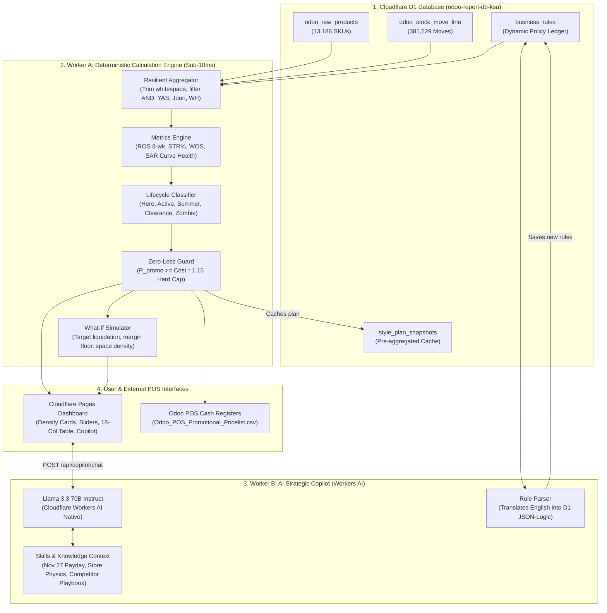
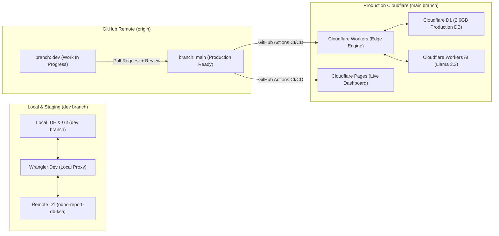

# CARINA Style Lifecycle Monitor & Strategic Discount Planner: System Map

This document details the architectural blueprint, folder structure, data flow, and environment topology for the production system.

---

## 1. Directory & Codebase Architecture

```
Discount planner AI/
├── .github/
│   └── workflows/
│       ├── deploy-prod.yml          # GitHub Actions: Auto-deploy to Cloudflare on push to main
│       └── test-dev.yml             # Run unit tests & policy checks on pull requests
├── public/                          # Cloudflare Pages Static Dashboard Assets
│   ├── index.html                   # Executive Single-Page Application (SPA)
│   ├── app.js                       # Frontend reactive logic, What-If slider, copilot drawer
│   └── styles.css                   # Responsive executive styling & store health cards
├── src/
│   ├── index.ts                     # Worker entry point & HTTP router (GET/POST endpoints)
│   ├── config/
│   │   ├── constants.ts             # Tax rate (15%), store areas (260, 193, 168 m²), thresholds
│   │   └── env.ts                   # Cloudflare Env interface (DB, AI, KV, SECRETS)
│   ├── db/
│   │   ├── schema.sql               # Auxiliary D1 tables (business_rules, snapshots, audit_log)
│   │   ├── d1Client.ts              # Resilient D1 database wrapper
│   │   └── queries.ts               # High-speed SQL queries for stock moves & product master
│   ├── engine/                      # WORKER A: Pure Deterministic Merchandising Math
│   │   ├── metricsCalculator.ts     # STR%, WOS, ROS (8-wk), SAR (Curve Health)
│   │   ├── zeroLossGuard.ts         # P_promo >= Cost * 1.15 hard mathematical floor
│   │   ├── lifecycleClassifier.ts   # 5-Stage Lifecycle State Machine
│   │   ├── rulePipeline.ts          # Middleware engine for dynamic D1 business rules
│   │   ├── simulator.ts             # Real-time What-If liquidation simulation calculator
│   │   └── posExporter.ts           # Formats & streams Odoo POS CSV pricelist
│   └── ai/                          # WORKER B: Cloudflare Workers AI Copilot
│       ├── copilot.ts               # Workers AI orchestrator (Llama 3.3 70B Instruct)
│       ├── promptTemplates.ts       # Structured system prompts & chain-of-thought rules
│       └── skills/
│           ├── ksaRetailContext.ts  # Payday (27th), VAT compliance, Jeddah vs Taif physics
│           ├── competitorPlaybook.ts# Counter-strategies for Centrepoint, Max, H&M, Nayomi
│           └── ruleParser.ts        # Compiles natural language requests into D1 JSON rules
├── tests/                           # Verification & Automated Test Suite
│   ├── zeroLossGuard.test.ts        # Verifies 0% below-cost sales across all styles
│   ├── metrics.test.ts              # Validates STR, ROS, WOS calculations
│   └── d1Resilience.test.ts         # Validates SQL queries with whitespace & split SKUs
├── .gitignore                       # Protects secrets, node_modules, .wrangler
├── package.json                     # Node/Wrangler scripts and dependencies
├── tsconfig.json                    # Strict TypeScript configuration
├── wrangler.toml                    # Cloudflare Worker, D1 DB, and AI bindings
├── SYSTEM_MAP.md                    # Complete system blueprint & architectural map
└── INSTRUCTIONS.md                  # Comprehensive operational, developer & security guide
```

---

## 2. End-to-End System Data Flow



---

## 3. Environment & Deployment Topology



---

## 4. Security Audit & Governance Enforcement

1. **Zero-Loss Mathematical Wall:** The zero-loss guard is executed in compiled TypeScript isolates, never inside prompt strings. No model hallucination can cause a style to be priced below `Cost * 1.15`.
2. **Shopify Isolation:** Database queries strictly match physical locations (`AND/Stock`, `YAS/Stock`, `Jouri/Stock`, `WH/Stock`). The `Shofy/Stock` phantom inventory is permanently barred from calculations.
3. **Store Density Balance:** Al-Andalus (260 m²), Al-Yasmeen (193 m²), and Jouri (168 m²) are continuously evaluated against target densities ($\le 35\text{ u/m}^2$).
4. **Secret Protection:** No API keys or credentials are committed to GitHub. Credentials reside securely in Cloudflare Secrets and `.dev.vars` (which is git-ignored).
